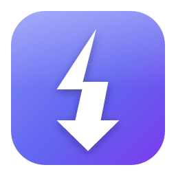
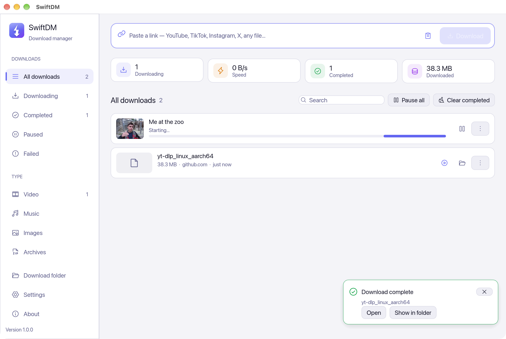

<div align="center">



# SwiftDM

[](https://github.com/itsmrroot/SwiftDM-release/releases/latest)
[](https://github.com/itsmrroot/SwiftDM-release/releases)
[](#-install)
[](https://www.rust-lang.org)

**Download videos, music and files from any link — YouTube, TikTok, Instagram, X, Facebook, SoundCloud,<br>
Vimeo and 1800+ more sites, or any direct file. Fast, resumable, and free.**

[](#-windows)
[](#-macos)
[](#-linux)

</div>

---

<div align="center">

</div>

## ✨ Features

<table>
<tr>
<td width="50%" valign="top">

### 🎬 1800+ video and music sites
Paste a link from **YouTube, TikTok, Instagram, X, Facebook, SoundCloud, Vimeo, Reddit, Twitch** and many more.
SwiftDM shows the title, thumbnail and length, and lets you choose the **quality (4K … 240p)** with the size of
each — or keep the **sound only as MP3** (best, 320, 192 or 128 kbps) with the cover art inside.

</td>
<td width="50%" valign="top">

### ⚡ Fast file downloads
Any direct link (programs, ISO images, archives, documents) downloads over **up to 32 connections at once**.
When one part finishes early, it helps with the slowest one, so the download stays fast until the end.

</td>
</tr>
<tr>
<td valign="top">

### ⏯️ Pause, quit, continue
Pause any download — or simply close the app — and continue later **from where it stopped**. Lost or frozen
connections reconnect on their own.

</td>
<td valign="top">

### 📋 Playlists and channels
Paste a playlist or channel link, tick the videos you want (or all of them), and they download one after the
other into a folder named after the playlist.

</td>
</tr>
<tr>
<td valign="top">

### 📎 Catches copied links
Copy a link anywhere — in the browser, a chat — and SwiftDM offers to download it. Or press **Ctrl+V / ⌘V** in
the window. A notification tells you when each download is complete.

</td>
<td valign="top">

### 🔐 Private and age-restricted videos
SwiftDM can use the login of your browser (Chrome, Firefox, Safari, Edge, Brave, …) — and tries it on its own
when a site refuses. It is read on your computer only and never sent anywhere else.

</td>
</tr>
<tr>
<td valign="top">

### 🧩 Nothing to set up
No Python, no command prompt. One click installs the free helpers (yt-dlp, FFmpeg, Deno) from their official
sources, checked against their published fingerprints, and SwiftDM keeps them up to date — sites change often.

</td>
<td valign="top">

### 🎨 Modern and light
A native app (not a web page), about 10 MB. Light, dark and night themes, six colours, any interface size.
Titles in Arabic, Chinese, Japanese and Korean show correctly. It updates itself.

</td>
</tr>
</table>

## 📥 Install

### 🪟 Windows

| Your PC | Download |
|---|---|
| **Most PCs** (Intel / AMD) | **[swiftdm-windows-x64-setup.exe](https://github.com/itsmrroot/SwiftDM-release/releases/latest/download/swiftdm-windows-x64-setup.exe)** |
| ARM (Snapdragon, Surface Pro X) | [swiftdm-windows-arm64-setup.exe](https://github.com/itsmrroot/SwiftDM-release/releases/latest/download/swiftdm-windows-arm64-setup.exe) |

Run the setup. No administrator rights are needed. If SmartScreen warns, click **More info → Run anyway** (the app
is not signed with a paid certificate yet).

### 🍎 macOS

| Your Mac | Download |
|---|---|
| **Apple Silicon** (M1 and newer) | **[swiftdm-macos-apple-silicon.dmg](https://github.com/itsmrroot/SwiftDM-release/releases/latest/download/swiftdm-macos-apple-silicon.dmg)** |
| Intel | [swiftdm-macos-intel.dmg](https://github.com/itsmrroot/SwiftDM-release/releases/latest/download/swiftdm-macos-intel.dmg) |

1. Open the `.dmg` and drag **SwiftDM** onto **Applications**.
2. The first time, macOS blocks the app because it is not signed by Apple yet:
   - **macOS 15 and newer:** open the app, click **Done**, then **System Settings → Privacy & Security → Open Anyway**.
   - **macOS 14 and older:** right-click the app → **Open** → **Open**.

### 🐧 Linux

| Your distribution | Intel / AMD (`x86_64`) | ARM (`aarch64`) |
|---|---|---|
| **Ubuntu, Debian, Mint, Pop!_OS** | **[swiftdm-linux-x86_64.deb](https://github.com/itsmrroot/SwiftDM-release/releases/latest/download/swiftdm-linux-x86_64.deb)** | [swiftdm-linux-arm64.deb](https://github.com/itsmrroot/SwiftDM-release/releases/latest/download/swiftdm-linux-arm64.deb) |
| **Fedora, openSUSE, RHEL** | [swiftdm-linux-x86_64.rpm](https://github.com/itsmrroot/SwiftDM-release/releases/latest/download/swiftdm-linux-x86_64.rpm) | [swiftdm-linux-arm64.rpm](https://github.com/itsmrroot/SwiftDM-release/releases/latest/download/swiftdm-linux-arm64.rpm) |
| **Any other** (AppImage) | [swiftdm-linux-x86_64.AppImage](https://github.com/itsmrroot/SwiftDM-release/releases/latest/download/swiftdm-linux-x86_64.AppImage) | [swiftdm-linux-arm64.AppImage](https://github.com/itsmrroot/SwiftDM-release/releases/latest/download/swiftdm-linux-arm64.AppImage) |

```bash
sudo apt install ./swiftdm-linux-x86_64.deb       # Ubuntu, Debian, Mint
sudo dnf install ./swiftdm-linux-x86_64.rpm       # Fedora, RHEL
chmod +x swiftdm-linux-x86_64.AppImage && ./swiftdm-linux-x86_64.AppImage
```

The command line alone (no window, static, any Linux) is in the `…-linux-musl.tar.gz` files on the
[release page](https://github.com/itsmrroot/SwiftDM-release/releases/latest).

## 🚀 Quick start

1. Open SwiftDM. The first time, click **Install helpers** (about 120 MB, once) — needed for video sites only.
2. Paste a link into the bar at the top and press **Download**.
3. Choose **Video** or **Sound only (MP3)** and the quality, then **Download**.

Files go to **Downloads/SwiftDM** — change it in **Settings**.

## 💻 Command line

The desktop app comes with the `swiftdm` command:

```bash
swiftdm https://youtu.be/…                  # best video
swiftdm -a -k 320 https://soundcloud.com/…  # MP3, 320 kbps
swiftdm -q 720 -o ~/Videos https://…        # 720p, into a folder
swiftdm -c 16 https://example.com/big.iso   # 16 connections
swiftdm --limit 2M https://…                # at most 2 MB/s
swiftdm info https://…                      # title, length, qualities, playlist items
swiftdm helpers install                     # install / update yt-dlp, FFmpeg, Deno
```

## ❓ FAQ

**A YouTube video fails with "sign in to confirm you're not a bot".**
Open **Settings → Logins**, choose a browser in which you are logged in to YouTube, and try again.

**A site that used to work fails.**
Sites change often. **Settings → Helpers → Update** next to yt-dlp — SwiftDM also does this on its own when it starts.

**MP3 doesn't work / only 360p is offered.**
FFmpeg is missing: **Settings → Helpers → Install**.

**Is it safe?**
SwiftDM downloads only what you ask for, sends nothing about you anywhere, and installs its helpers from their
official sources (GitHub releases of yt-dlp, FFmpeg builds and Deno), checking their fingerprints.

**Please** download only what you have the right to, and respect the terms of the sites you use.

## 🙏 Made with

[yt-dlp](https://github.com/yt-dlp/yt-dlp) · [FFmpeg](https://ffmpeg.org) · [Deno](https://deno.com) ·
[egui](https://github.com/emilk/egui) · [Rust](https://www.rust-lang.org) · Noto Sans Arabic

---

<div align="center">

MIT License · © 2026 Bashar Salmo · **Powered by Bashar Salmo**

</div>
